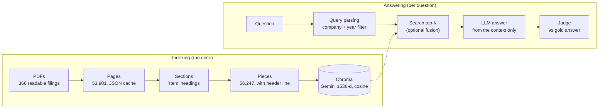

## 1. Requirments

For this project to run you will need:
 - A gemini API key (free tier available)
 - A huggingface API key (free tier available)
 - the FinanceBench PDFs in `Data/financebench/pdfs` (see [2. Data](#2-data))

Both keys go in a `.env` file at the project root (copy `.env.example`).

## 2. Data

The documents come from **FinanceBench** by Patronus AI:
 - PDFs: [github.com/patronus-ai/financebench](https://github.com/patronus-ai/financebench) (368 SEC filings and earnings reports: 10-K, 10-Q, 8-K)
 - Questions and metadata: [huggingface.co/datasets/PatronusAI/financebench](https://huggingface.co/datasets/PatronusAI/financebench) (150 questions, covering 84 of the 368 documents), loaded in the notebook with `load_dataset("PatronusAI/financebench")`

The PDFs are not part of this repository. To get them:

```bash
git clone --depth 1 https://github.com/patronus-ai/financebench Data/financebench
rm -rf Data/financebench/.git   # keep the files only, not the other repository
```

Only `Data/financebench/pdfs/` is used, the other files of the clone can be deleted.

## 3. Pipeline



1. **Ingestion.** `load_pdfs` extracts the text of each page and caches it on disk.
2. **Sectioning.** `split_by_section` cuts each filing at its "Item" headings, so each piece carries its section title.
3. **Embedding.** Each piece is prefixed with a short header (company, filing, section) and embedded with `gemini-embedding-001` (1536 dimensions). Vectors are stored in a Chroma collection with cosine distance. A piece is re-embedded only if its id or its text hash changed, so a rerun after a crash does not repeat paid work.
4. **Query parsing.** `query_parsing.py` finds the company (alias table) and the filing year (`2022`, `FY2022`, `FY22`) in the question, without a language model, and builds a metadata filter. The company is a hard filter, the year accepts the filing year and the next one. A filter that matches nothing is relaxed step by step: company and year, company alone, whole collection.
5. **Retrieval.** The question is embedded and the `K` closest pieces are returned. Optionally (`USE_FUSION`), a model also writes rewrites of the question, each is searched with the same filter, and the result lists are merged by reciprocal rank fusion (`fusion.py`). It is off by default, see the evaluation.
6. **Generation.** The pieces are inserted in a prompt and a Gemini model answers from them only (`rag.py`, and the last section of `rag_system.ipynb`).

## 4. Project structure

```
RAG/
├── Data/
│   ├── financebench/pdfs/    # FinanceBench PDFs (downloaded, see 2. Data)
│   ├── cache/pages/          # extracted text, one JSON per PDF (generated by load_pdfs, git-ignored)
│   ├── chroma/               # vector store, ~56k pieces (generated by the notebook, git-ignored)
│   ├── eval/                 # evaluation results: retrieval per scope, fusion rewrites, answers and verdicts (generated)
│   └── logs/                 # pypdf warnings, one JSON object per line
├── src/
│   ├── rag_system.ipynb      # main notebook: ingestion, sectioning, embedding, retrieval and generation
│   ├── evaluation.ipynb      # retrieval evaluation and answer evaluation against the FinanceBench questions
│   └── helpers/
│       ├── ingestion.py      # load_pdfs: parallel PDF loading (one process per core) with the on-disk cache
│       ├── sections.py       # 10-K / 10-Q / 8-K "Item" heading detection, split_by_section
│       ├── embedding.py      # prepare / index / search: pieces, Gemini embeddings, Chroma collection
│       ├── query_parsing.py  # company aliases, year / fiscal year / quarter parsing, build_where filter
│       ├── fusion.py         # RAG-Fusion: question rewrites, reciprocal rank fusion, fused search
│       ├── rag.py            # retrieval with filter fallback, answer generation
│       ├── evaluation.py     # retrieval_eval (recall@k, MRR), answer_eval, LLM judge
│       └── pdf_logging.py    # JSON formatter for the pypdf warning logs
├── tests/
│   ├── test_sections.py      # tests for sections.py and ingestion.py (python tests/test_sections.py)
│   └── test.ipynb            # LangChain + Gemini agent test
├── .env.example              # GOOGLE_API_KEY, HF_TOKEN
└── requirments.txt
```

Both notebooks are run with `src/` as the working directory.

## 5. Evaluation

### Retrieval

`evaluation.ipynb` first measures retrieval alone. For each of the 150 questions, the top 10 pieces are retrieved and the rank of the first one lying on a gold evidence page (same document and page) is recorded. The test is run with six search scopes. `company` and `doc` are *oracle* scopes, their filter is read from the dataset labels; the other filters come from the question text only.

| Scope | Filter | recall@1 | recall@5 | recall@10 | MRR |
|---|---|---|---|---|---|
| `none` | none | 0.43 | 0.78 | 0.87 | 0.58 |
| `company` | company of the question (oracle) | 0.46 | 0.86 | 0.92 | 0.62 |
| `doc` | exact filing of the question (oracle) | 0.51 | 0.92 | 0.97 | 0.68 |
| `rules` | company found in the question text | 0.46 | 0.85 | 0.91 | 0.62 |
| `rules_year` | `rules` plus the filing year | 0.46 | 0.87 | 0.93 | 0.62 |
| `fusion` | `rules_year` filter, ranking by RAG-Fusion | 0.49 | 0.84 | 0.92 | 0.64 |

- `recall@k`: share of questions whose gold page is among the first `k` results.
- `MRR`: mean of 1/rank over the questions, a miss counting as 0.
- Results are saved in `Data/eval/` and reused on a rerun; pass `refresh=True` to run the queries again after changing the parser, the index or the fusion settings.

Findings:
- The company and year found by rules give the same retrieval as the oracle company filter, using the question text alone.
- Fusion improves the first-place rate (recall@1 0.46 to 0.49) but not recall@5 or recall@10, and costs one extra model call per question. The difference is about five questions, within noise, so it is off by default.
- Even with the exact filing known, the right page is first for about half of the questions while it is in the top 10 for 97%: the remaining problem is ranking.
- Only the 84 filings used by the questions carry `company_name` and `year` metadata, so a company filter also removes the other filings from the search. Part of the gain over `none` comes from that.

### Answers

The answer evaluation runs the system on the questions and has a language model judge each answer against the gold answer (verdict and one-sentence reason). Accuracy is read separately for questions where a gold evidence page was in the context, to tell generation errors from retrieval errors. Answers and verdicts are cached in `Data/eval/`. The full run has not been done: on a first trial of 10 questions, 7 were judged correct and a gold evidence page was in the context for all 10, which is too few questions to be an estimate. The judge belongs to the same model family as the answering model and can be strict on rounding, so a sample of its reasons should be read.
